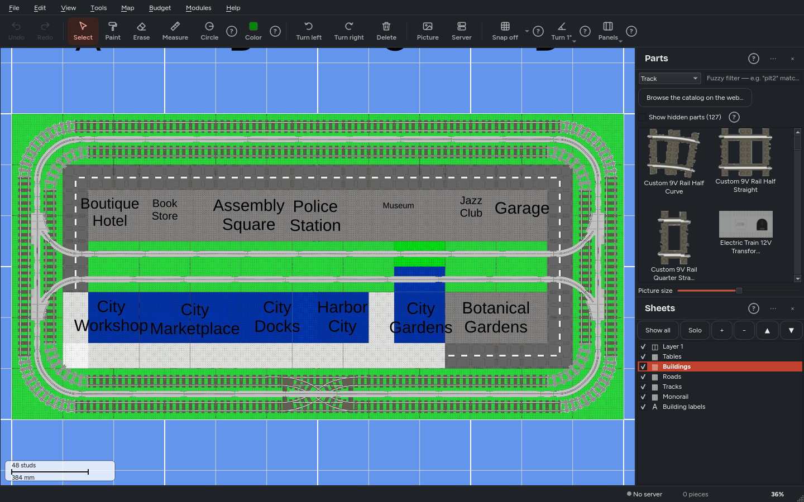
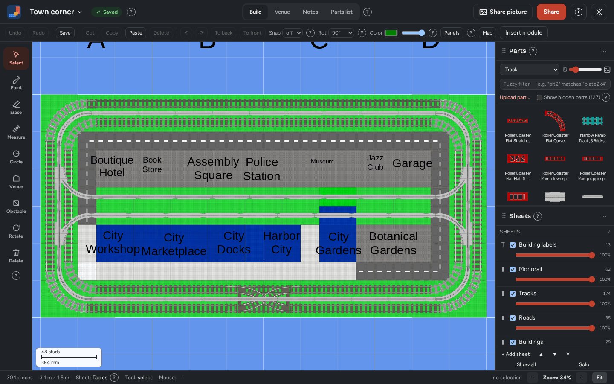
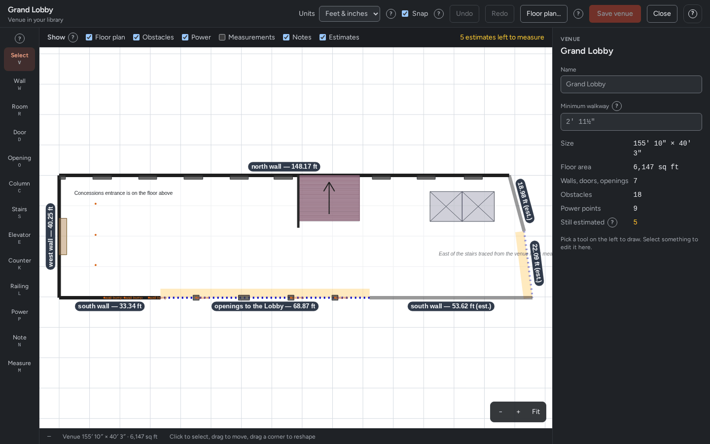

  

# Collaborative Brick Layout Designer

Open-source tools for planning LEGO train and town layouts, from solo planning to a whole club editing the same layout at once. There's a desktop app and a self-hosted web app, and they share the same layouts, accounts and files.

*The desktop app: a town layout with track, roads and buildings, and the parts library beside it.* [View in light mode](https://github.com/collaborative-brick-layout-designer/.github/blob/main/profile/desktop-editor-light.png)

*The web app: the same layout in the browser, ready to edit with your club.* [View in light mode](https://github.com/collaborative-brick-layout-designer/.github/blob/main/profile/web-editor-light.png)

*Venues: draw the hall, then get warned when track comes too close to a wall or a walkway.* [View in light mode](https://github.com/collaborative-brick-layout-designer/.github/blob/main/profile/web-venue-light.png)

---

## Projects

### 🖥️ [desktop](https://github.com/collaborative-brick-layout-designer/desktop)

The desktop app is a cross-platform fork of **[BlueBrick](https://github.com/Lswbanban/BlueBrick)**, rewritten in C++20 and Qt 6. It runs natively on Windows, macOS (Apple Silicon and Intel) and Linux, with no .NET or Mono. It does everything BlueBrick 1.9.2 does with the same `.bbm` files, and adds:

- **Modules:** bundle parts into a named piece you can pin, edit, save to a library and drop into other layouts.
- **Venues:** draw the hall (walls, doors, obstacles, power points) and get warned when track gets too close to a wall or a walkway.
- **Sets, flex track you can bend, electric circuits, anchored labels, saved views, and picture and PDF export.**
- **Imports:** turn LDraw, Studio and LDD models into library parts.
- **Live editing with a club:** connect to a server, see everyone's changes and cursors as they happen, keep working offline and merge back later.
- **Ease of use:** touchscreen support, light, dark and color themes, guided tours, and 10 languages besides English.

[**Download the latest release**](https://github.com/collaborative-brick-layout-designer/desktop/releases/latest): Windows `.msi` or `.zip`, macOS `.dmg` or `.zip`, Linux AppImage or `.tar.gz`. Releases aren't code-signed, so Windows and macOS ask once before the first start.

### 🌐 [web](https://github.com/collaborative-brick-layout-designer/web)

A web app for planning layouts together in the browser, and the server the desktop app connects to. You self-host it as one Docker container, so you own your data.

- **Live editing in the browser:** BlueBrick's parts library, connection snapping and undo that only undoes your own changes. It works on a desktop, a tablet or a phone.
- **Clubs:** shared layouts, modules, venues and parts, with roles you can customize (Admin, Manager, Member, Viewer, or your own).
- **Sharing:** a public catalog of modules, parts, venues and layouts, with optional moderation.
- **Custom parts and sets**, plus `.bld-layout` and BlueBrick `.bbm` files in and out.
- **Privacy:** GDPR-friendly, with data export and account deletion.

[**Self-hosting guide**](https://github.com/collaborative-brick-layout-designer/web#self-hosting-with-docker)

---

## Built on BlueBrick

Both apps stand on the shoulders of **[BlueBrick](https://github.com/Lswbanban/BlueBrick)** by Alban Nanty and the community **[BlueBrickParts](https://github.com/Lswbanban/BlueBrickParts)** library. The file format, parts library, connection snapping and sheet (layer) system all come from BlueBrick's design, and layouts move freely between these apps and vanilla BlueBrick.

If you want the mature, battle-tested tool, use BlueBrick. If you want native builds on every platform or real-time collaboration, you're in the right place.

**Please star the original [BlueBrick](https://github.com/Lswbanban/BlueBrick) and [BlueBrickParts](https://github.com/Lswbanban/BlueBrickParts) repos.** They're the foundation of all of this.
